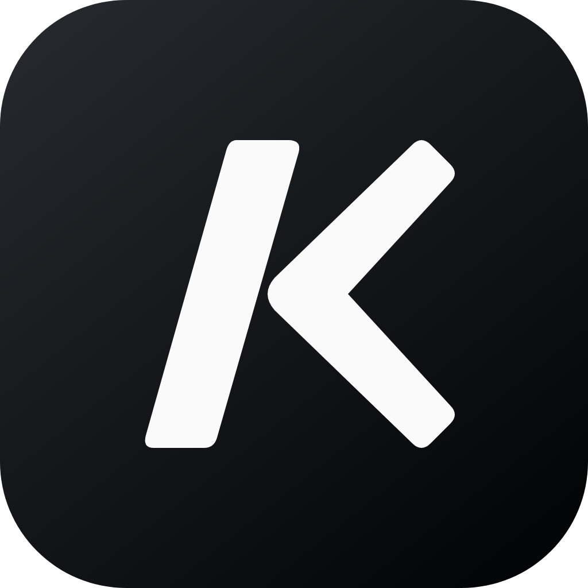
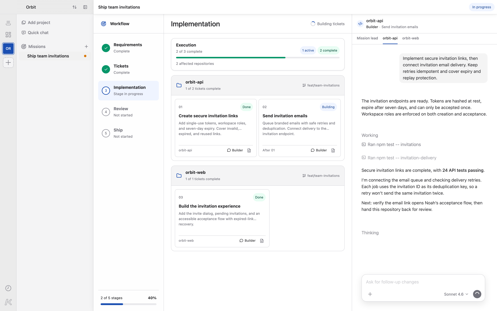

  

<h1 align="center">Korus</h1>

  

  <strong>Build with agents. From idea to delivery.</strong> 
  Build with a team of coding agents—across repositories and machines.

  <a href="#get-korus"><strong>Get Korus for macOS, Windows, and Linux</strong></a>
  ·
  <a href="https://meetkorus.dev">Website</a>

  

Korus brings your coding agents into one workspace. Use one engine
on its own or run a mixed team: give agents their own conversations and
workspaces, see what everyone is doing, and step in when your input is needed.

Korus is free to use. Connect your provider accounts; provider subscriptions
and API usage are billed separately.

## One cockpit for the whole team

- **Run a real team** — Organize agents into teams, give each one a repository,
  identity, conversation, and durable workspace, then switch between them
  without interrupting their work.
- **Choose your engines** — Connect the coding providers you use. Use different
  engines for different agents; available controls reflect each engine's
  supported capabilities.
- **Work across machines** — Connect teams on other machines over SSH and
  manage their agents alongside local teams.
- **See the work, not a terminal stream** — Follow messages, plans, reasoning,
  tool calls, approvals, command output, file changes, and diffs in a native
  conversation UI.
- **Let agents collaborate** — Agents can discover teammates, share status,
  send messages, queue follow-up work, and coordinate through Korus's
  built-in MCP tools.
- **Bring people into the conversation** — Share a live conversation with a
  collaborator who can follow the work and suggest prompts. You review, edit,
  and send each suggestion, and can stop sharing at any time.
- **Browse without leaving** — Every agent can keep an in-app browser for
  research, local previews, and browser-based tools. Share website sign-ins across
  agents and use Bitwarden or 1Password from the browser toolbar.
- **Teach agents new skills** — Discover curated skills and packs, install from
  GitHub or skills.sh, read their instructions, and sync them across your local
  coding agents in Settings.
- **Use the computer when code is not enough** — Opt-in Computer Use lets agents
  inspect and operate macOS applications while you keep the session visible.
- **Review with context** — Open Git changes, source files, turn-specific diffs,
  Markdown, execution plans, and Plan-mode proposals beside the conversation.
- **Keep Codex work accessible from your phone** — Pair Codex mobile with
  Korus's Codex connection while agents continue running through the background
  backend. This pairing is specific to Codex.
- **Take your team with you** — Pair the iPhone or Android companion with your
  computers, switch saved connections, and follow agents across teams. Respond to
  requests and send follow-ups while work continues on the connected computer.
- **Bring your backlog** — Connect GitHub, GitLab, or Linear to browse issues, start
  agent work, or shape a Mission. Choose the code repository separately from a
  Linear team or project. Deliver through GitHub pull requests or GitLab merge requests.
- **Schedule recurring work** — Send prompts to an existing agent or Quick Chat,
  or start a fresh Quick Chat each time. Choose daily, weekday, weekly, custom,
  or interval schedules, or ask an agent to create an automation from chat.

## From idea to delivery

- **Missions** — Shape a feature through Requirements, Tickets, Implementation,
  Review, and Ship. Approve the brief and tickets, follow workers across
  repositories, review findings, and deliver through pull requests or merges.
- **Delegate** — Discuss a task, then use `/delegate` (or `/worktree`) to send a
  self-contained handoff to a new Korus teammate in a dedicated worktree. Your
  original conversation stays open; pushing and merging remain separate decisions.
- **Review** — Use `/review` to assess a branch or uncommitted changes with an
  independent reviewer or the current agent. Inspect structured findings,
  choose which fixes to apply, and run another review round. Save shared review
  instructions in Settings → Workflows.
- **Visualize** — Use `/visualize` to explore designs on an editable diagram
  canvas beside the conversation. Annotate a shape to request a targeted change
  without losing your other edits.
- **Hand off** — Continue an idle task with a replacement agent, optionally
  switching engines or models. The current agent writes a handoff note; the
  replacement works in the same folder, with the source history still accessible.

Review, Delegate, and Visualize are also available from the composer's **+** menu.

## Built around your workflow

Create agents from repositories and give each one a prompt, then move freely
between active conversations: drafts, attachments,
queues, model settings, browser tabs, and sidebar state stay with the agent.

Queue a follow-up while an agent is working; Korus sends it when the current
turn finishes. Both Codex and Claude Code support steering; Claude receives the
update at a tool boundary or in a following turn, rather than immediately
interrupting a running tool. Claude also supports idle conversation forks in
the same folder and native goals; its goals do not support token budgets.

Keep two or four agents visible in split panes, with one shared artifact sidebar
following the focused agent. Resize panes and keep each team's layout across
restarts. Let project creation, worktree setup, and cleanup run in the background
while you continue working. With the background backend enabled, closing the
desktop app leaves the team running. Saved workspace state is restored when
you return.

When a provider supplies a usage-limit reset time, Auto-resume can continue the
conversation after the reset. Compare token usage, estimated API costs, and
output speed over time in Settings → Analytics. Usage statistics and cost
calculations stay on your computer.

## Get Korus

Korus is available for macOS on Apple silicon, Windows x64, and Linux
x64/ARM64. Download it from [GitHub Releases](https://github.com/Korus-Dev/korus/releases).
Prereleases require manual downloads; automatic updates
on macOS and installed Windows copies follow stable releases only. Windows
installers are unsigned. Linux and portable Windows updates are manual.

1. Download a published installer for your platform and architecture from GitHub Releases.
2. Install and launch Korus:
   - **macOS:** Open the DMG and double-click Korus to install and launch it.
   - **Windows:** Run the installer, or extract the portable ZIP and launch Korus.
   - **Linux:** Install the DEB or RPM for your architecture, or extract the ZIP
     and launch Korus.
3. Install and connect a coding engine, then choose Continue. Only one connected
   engine is required. See the [provider guides](https://meetkorus.dev/docs/providers/)
   for installation and sign-in, including Antigravity's ACP runtime.
4. Create a team, add an agent from a repository, and start coding. When multiple
   engines are enabled, choose which one the agent uses.

Korus uses your existing Codex and Claude Code setup by default, including their
sign-in. Choose Customize during setup to keep Korus conversations in a separate
environment instead. A separate setup requires its own sign-in.
You can also share existing provider skills with a separate setup. Settings shows
each engine's account, conversation location, and enabled state.

